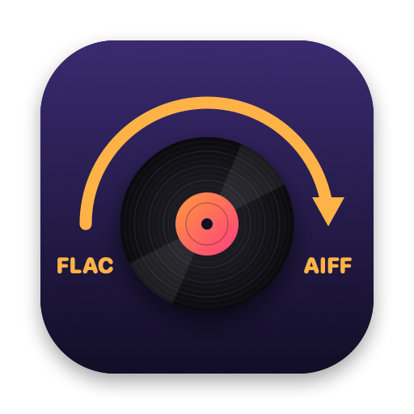

<div align="center">



# FlacToAiff

**Drag-and-drop FLAC → AIFF conversion for macOS. Lossless, verified, tags included, zero dependencies.**


</div>

---

FlacToAiff is a small native Mac app for turning `.flac` files into `.aiff`, the format
expected by rekordbox, Serato, Apple Music and many CDJs. Drop files or folders on it, or let it
watch your downloads folder. The converted copies appear in your output folder with their
metadata and cover art intact, and each one is checked against the FLAC before it is saved.

## Features

- **Drag and drop**: onto the window or the Dock icon, or use Finder's **Open With**. Folders
  keep their structure (`Album/CD1/…`).
- **Watch folder**: new FLACs that land in a folder you choose convert automatically, once they
  have finished downloading.
- **Lossless**: the sample rate is kept and the bit depth matched, so the audio is identical to
  the FLAC's.
- **CDJ and CD formats**: optional modes for older CDJs (max 24-bit / 48 kHz) and for burning
  audio CDs (16-bit / 44.1 kHz).
- **Tags and artwork carried over**: title, artist, BPM, key, cover art and more, as an ID3 tag
  that rekordbox, Serato and Apple Music read.
- **Every file verified**: audio, format, length and tags are checked before the AIFF is saved.
  A file that fails a check is never saved.
- **Safe**: existing files are never overwritten, and a half-written AIFF never appears. Saving
  straight to a USB stick (exFAT or FAT32) works.
- **No dependencies**: built on macOS's own `afconvert` audio engine. No ffmpeg, no Homebrew.

## Requirements

- macOS 12 Monterey or later, on Apple Silicon
- Xcode Command Line Tools to build (`xcode-select --install`); the full Xcode is not needed

## Installation

```bash
git clone git@github.com:SudoShinichi/flactoaiff.git
cd flactoaiff
./build.sh
```

This produces `build/FlacToAiff.app`. Drag it into `/Applications` to install it.

## Usage

1. Open **FlacToAiff**.
2. Drag `.flac` files or folders onto the window.
3. Find the converted `.aiff` files in the **Save to** folder (Downloads by default). Click
   **Reveal in Finder** to jump to them.

You can also drop files or folders on the app's Dock icon, even when the app isn't running, or
right-click FLACs in Finder → **Open With → FlacToAiff**. The app never becomes the default app
for FLAC files.

### Settings

- **Save to**: where the AIFFs go. Click it to choose another folder, such as a USB stick.
- **Format**: which players the files must play on. The line under the menu explains each one.

  | Format | Output | For |
  | --- | --- | --- |
  | Original (lossless) | Same sample rate; 16, 24 or 32-bit to match the source | CDJ-3000/3000X, CDJ-2000NXS2 (USB/SD), rekordbox, Serato, Music |
  | CDJ: max 24-bit / 48 kHz | Hi-res is resampled (96 → 48 kHz, 88.2 → 44.1 kHz) and capped at 24-bit | CDJ-2000NXS, 2000, 900NXS, 850, 350, XDJ-1000MK2 |
  | CD: 16-bit / 44.1 kHz | Resampled and dithered to CD format | Burning audio CDs for CD-only players |

  Files that are already within a format's limits are converted unchanged in every mode.
- **Watch**: a folder to convert new FLACs from automatically (see below).

Changing a setting affects the next files you drop, not the ones already converting.

### Reading the results

Each file gets a row in the window:

| Row | Meaning |
| --- | --- |
| ✓ `→ track.aiff · verified` | Converted, and the audio is bit-for-bit identical to the FLAC. Format, length and tags are checked too. |
| ✓ `→ track.aiff (96 → 48 kHz) · tags verified` | Converted with a format change, so the audio can't be identical by design. Format, length and tags are checked. |
| ✓ `… · format checked` | Converted. There were no tags to check, and the audio either wasn't lossless or the FLAC carries no checksum. |
| ⏭ `Already converted` | An AIFF with that name is already in the output folder. It was left untouched. |
| ✕ red | Not converted, with the reason. Nothing was saved (see [Troubleshooting](#troubleshooting)). |

To convert a track again, for example in another format, delete its AIFF and drop the FLAC again.

Quitting while files are still converting asks first. Files that were already converted are kept,
and you can drop the rest again later.

### Watch folder

Click **Watch** and choose a folder, for example the one your browser downloads into. While the
app is open:

- New FLACs that land there convert into **Save to** with the current format. That includes
  albums unzipped or moved in, and their subfolders are kept: `Watch/Album/01.flac` becomes
  `Save to/Album/01.aiff`.
- A file is converted once it has stopped changing, so downloads still in progress are left
  alone. If a stalled copy turns out incomplete, its row says so, and it converts once finished.
- FLACs that arrive while the app is quit are converted at the next launch.
- Files already in the folder when you start watching are left alone. Renaming or re-sorting
  converted albums inside the folder doesn't convert them again while the app is running. After
  a relaunch, a rename counts as a new arrival.

Choose **Stop Watching** to turn it off.

### Metadata

FLAC tags (Vorbis comments) are mapped to ID3v2.3, the version DJ software reads most reliably:

| FLAC tag | ID3 frame | | FLAC tag | ID3 frame |
| --- | --- | --- | --- | --- |
| `TITLE` | Title | | `BPM` | BPM |
| `ARTIST` | Artist | | `INITIALKEY` | Key |
| `ALBUM` | Album | | `ORGANIZATION` / `LABEL` | Label / publisher |
| `ALBUMARTIST` | Album artist | | `DATE` / `YEAR` | Year |
| `GENRE` | Genre | | `TRACKNUMBER` / `DISCNUMBER` | Track / disc (with totals) |
| `COMPOSER` | Composer | | `COMMENT` | Comment |
| `REMIXER` | Remixer | | `ISRC` | ISRC |

Embedded pictures become cover art, and any other tags are kept as custom (`TXXX`) fields.
Non-Latin text is preserved. FLACs that carry an extra ID3 tag in front of the FLAC data, as some
taggers write, are read too.

## How it works

1. **Convert.** Apple's built-in `afconvert` decodes the FLAC and writes the AIFF to a hidden temp
   file next to the output.
   - Lossless: `afconvert -f AIFF -d BEI<depth> in.flac out`.
   - Resampled: adds `@<rate> -r 127 --src-complexity bats` (highest quality).
   - CD mode: adds `--dither 1` (TPDF) when it reduces the bit depth.
2. **Tag.** `afconvert` copies audio only, so FlacToAiff reads the FLAC's metadata blocks and
   appends an `ID3 ` chunk to the AIFF.
3. **Verify.** The audio checks use the FLAC's STREAMINFO header, which holds the track's length
   and an MD5 fingerprint of its audio.
   - The AIFF's length must match.
   - For lossless output, the MD5 of the AIFF's samples must equal the FLAC's fingerprint.
   - Every tag and picture must read back identically through AVFoundation, the framework Apple
     Music is built on.
4. **Publish.** The temp file is renamed into place without ever replacing an existing file. On
   volumes without atomic exclusive rename (exFAT, FAT32, many network shares), it falls back
   safely.

| File | Purpose |
| --- | --- |
| `Sources/main.swift` | SwiftUI window (drop zone, settings bar, results), app delegate, and the headless `--convert` / `--watch` modes |
| `Sources/Converter.swift` | Output-format choice (resampling/dither), `afconvert` invocation, atomic saving |
| `Sources/Tags.swift` | FLAC STREAMINFO, tag and picture parsing; ID3 writing; AIFF reading |
| `Sources/Verifier.swift` | Checks each AIFF before it is saved: audio fingerprint, format, length, tags |
| `Sources/Jobs.swift` | Expands dropped files/folders into conversions and runs them |
| `Sources/FolderWatcher.swift` | Watch folder: FSEvents, waits for files to finish being written, launch catch-up |
| `Sources/Settings.swift` | Remembered output folder, output format and watch folder |
| `Sources/ConversionQueue.swift` | Background conversion queue shared by the window, Dock, Open With and the watch folder |
| `scripts/make-icon.swift` | Draws the app icon in code; rendered by `build.sh` |

## Development

```bash
./build.sh && ./test.sh
```

The end-to-end test synthesizes real FLAC files and runs the actual conversion core. It covers:
- bit-depth and sample-rate handling in every format
- duplicate skipping and concurrent conversions
- rejecting non-FLAC, corrupt and truncated input
- tag and artwork carry-over, including odd tags
- output verification, including tampered files being refused
- the watch folder, and saving to an exFAT volume

`test.sh` also builds its own test binary with `-D TEST_HOOKS`, to drive failure paths that real
files can't reach. The app itself never contains them.

A headless mode is available for scripting:

```bash
build/FlacToAiff.app/Contents/MacOS/FlacToAiff --convert [--format original|max48|cd] <file-or-folder>... <output-dir>
build/FlacToAiff.app/Contents/MacOS/FlacToAiff --watch [--format original|max48|cd] [--catch-up-since <unix-time>] <watch-dir> <output-dir>   # until Ctrl-C
```

Each converted file prints `OK <path>`, a tab, and what was verified (`verified`,
`tags verified` or `format checked`). An existing file prints `SKIP <path>`. Failures print
`ERROR <name>: <reason>` to stderr and exit 1.

## Troubleshooting

**"App can't be opened" / Gatekeeper warning.** Builds you make yourself open with a plain
double-click. A copy received via browser download or AirDrop is quarantined. Right-click →
**Open** once, or run `xattr -dr com.apple.quarantine FlacToAiff.app`. The app is ad-hoc signed
(`local.flactoaiff`) and has no Developer ID.

**Folder permission prompt.** The first time the app writes to Downloads (or another protected
folder like Desktop or Documents), macOS asks for permission. Click **OK**. Launch the app from
Finder rather than running the binary from Terminal, so the permission is granted to FlacToAiff
itself.

**"FLAC is incomplete — only N% of the audio is there".** The FLAC is shorter than its header
says. It is still downloading or copying, or the download broke off. Wait for it to finish, or
download it again. In a watch folder, it converts by itself once the file is complete.

**"Audio doesn't match the FLAC's checksum — the FLAC may be damaged".** The decoded audio
doesn't match the fingerprint the FLAC was made with, so the FLAC file itself is probably
corrupt. Download it again.

**"Tag check failed: …".** A tag didn't read back as written, so the file wasn't saved. This
shouldn't happen. Please open an issue with the FLAC's tags (for example the output of `metaflac --list`).

**Output folder not available — choose another in “Save to”.** The output folder was renamed,
deleted or is on a drive that isn't connected. Plug the drive back in, or choose another folder.
Files from the watch folder that failed this way are tried again at the next launch.

**"Watch folder not available".** The watch folder was renamed, deleted or is on a disconnected
drive. Choose it again under **Watch** once it's back.

**A track shows its file name instead of its title.** It was converted by a version from before
tag support. Delete the AIFF and convert it again.
